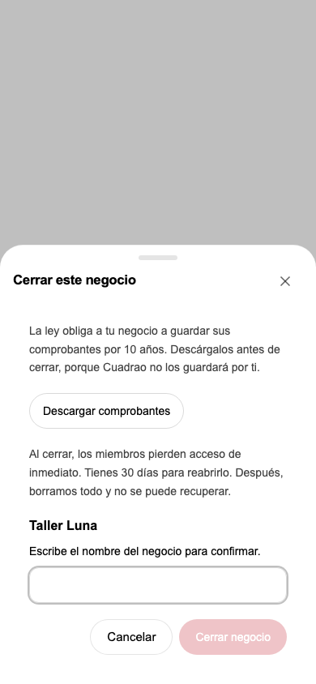
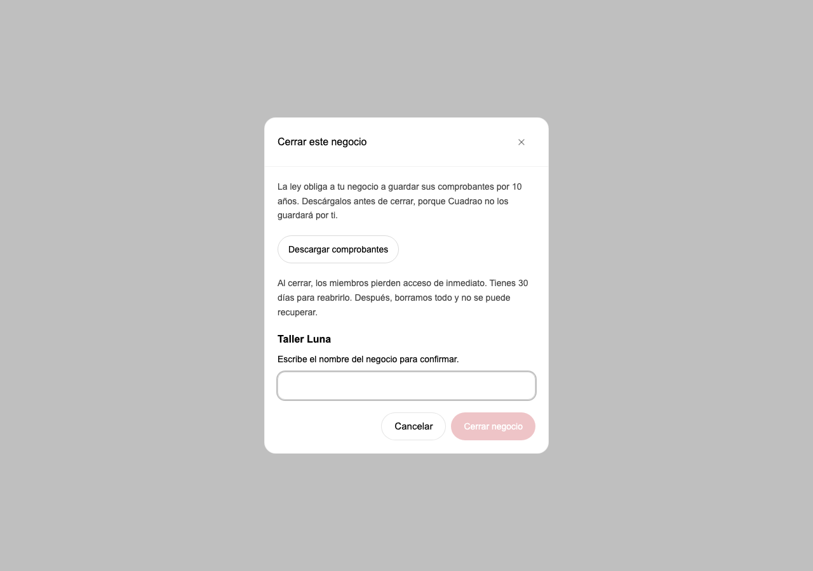

# Business lifecycle checkpoint, October 18, 2026

This is a WIP domain checkpoint. It is not customer-ready. The full lane remains
held until the receipt three-case gate and an independent exact-head evaluation.

## Owned result

The new Postgres domain service closes and reopens an existing Business using
`spaces.closed_at`, the current shared access gate. Close requires the exact
current name. Existing grant IDs and capabilities remain unchanged. Reopen
restores only grants still live before the 30-day deadline. Scoped command
history prevents delayed retries from reversing later commands. Another open
Business prevents reopening under the existing one-open constraint.

The domain service remains unavailable to the application. A later WIP transport
checkpoint below adds an unmounted, unconditionally denied router and an
unmounted dialog.
Account deletion stays globally disabled. No hosted SQL, provider call, email,
environment file change, receipt code edit or export code edit was performed.

## Verification

The failing-first run could not import the absent lifecycle module. The completed
focused run passed 32 tests with zero skips, including 24 new lifecycle cases,
six existing access cases and two existing Business account-deletion guard cases.
The held-lock cases prove that close waits for a protected operation and reopen
checks the deadline after the space lock becomes available. Replays, exact-name
refusal, expiry, revoked grants, original result after rename, concurrent duplicate
commands, server-only storage and append-only service-role grants are covered.
Ruff, diff whitespace and the modularity budget passed locally.

Tests use Python 3.10.20 and only `business_close_testdb` on the root-owned local
Postgres instance at port 59432. The database was created for this lane from a
schema-only baseline dump. The fixture includes `public`, `auth`, `argus_private`
and `extensions`. Managed cron setup, other managed schemas and ALTER DEFAULT
PRIVILEGES statements were excluded. Local vector, pgcrypto and pg_trgm extension
types were installed only in this test database. The new migration was applied
only there. The baseline database and all other lanes were preserved.
Provider keys were blanked for the test command. No environment files were created.

A race test found that an auth-user `FOR UPDATE` lock could conflict with a
space writer's foreign-key key-share lock. `FOR NO KEY UPDATE` keeps lifecycle
commands serialized while permitting that key-share lock. The final 32-test
run includes the reproducer and passed.

## Exact founder-approved copy

The coordinator relayed Lucas/Iris's approval during this assignment. Preserve
these strings exactly in the later UI and email implementation.

Title.

> Cerrar este negocio

Warning.

> La ley obliga a tu negocio a guardar sus comprobantes por 10 años. Descárgalos antes de cerrar, porque Cuadrao no los guardará por ti.

Consequences.

> Al cerrar, los miembros pierden acceso de inmediato. Tienes 30 días para reabrirlo. Después, borramos todo y no se puede recuperar.

Confirmation field.

> Escribe el nombre del negocio para confirmar.

Buttons.

> Descargar comprobantes
>
> Cerrar negocio
>
> Cancelar

Member email subject.

> {Negocio} se cerró en Cuadrao

Member email body.

> Hola, {Dueño} cerró {Negocio} en Cuadrao el {fecha}, y ya no tienes acceso. Si necesitas copias de los comprobantes, pídeselas a {Dueño}. Si el negocio no se reabre antes del {fecha_borrado}, sus datos se borrarán. Saludos, Cuadrao

## Approved full-lane behavior still to implement

- Sole Business owners must transfer ownership or close the Business before
  account deletion. Both choices need working links.
- Transfer selects an existing Editar member and requires the actual Business
  name. It stays pending until that member accepts in the web app. The owner can
  cancel. Acceptance makes the recipient owner and the former owner Editar.
  Transfer sends no email. The former owner's account deletion then unblocks.
- A closed Business retains its original 30-day schedule if its owner deletes
  their account. The Business and receipt originals must survive that deletion.
  With no owner, nobody may reopen it. Members remain denied.
- The existing operator deletion sweep must purge the complete Business,
  including receipt originals, at day 30. No staging purge is authorized for this
  build. The 10-year fiscal duty belongs to the Business, not Cuadrao.
- Reopen restores prior members through still-live grants and creates no invites.
- The close UI reuses the current export behavior without editing export code.
  Member email uses only the staging sender. No automatic real email test runs.

## Architecture boundary requiring the next owner

`spaces.created_by` currently means current owner, storage custodian and the
composite foreign-key target for financial accounts, source connections, import
events and conversations. Their `user_id` columns must match it. The grant
approval trigger and Business authority also read `created_by`.

The existing account-deletion service deletes every Storage object below the
old user's owner prefix. Therefore, changing only space ownership or its account
foreign key would fail either the record constraints or the receipt-retention
contract. The next design must separate current ownership from durable record
custody and map the exact affected methods before it changes any protected
receipt path. Root owns that architecture assignment and any boundary exception.

Current relevant owners include `authority.authorize`, `PostgresAccessStore`,
`PostgresSpaceStore`, `resolve_business_scope`, `business_drafts.scoped_legacy`,
`business_grant_approve_owner_only`, account deletion `_claim`,
`_delete_in_transaction`, `_settle_late_writes` and `_erase_sources`.

## Resume and hold

The isolated checkout is `/private/tmp/cuadrao-business-close-lifecycle-20261018`.
The branch is `codex/business-close-lifecycle-20261018`, based on freshly fetched
integration `651870a54be4e5506dbb38f3902fef1a97eef8df`. No helper shares this writer's
checkout. The author model is `gpt-6.1-sol` with high reasoning. Root owns the
fresh independent evaluation, expanded architecture, final CI and the merge hold.

## Independent transport and dialog checkpoint

The coordinator assigned only new lifecycle transport, a standalone close dialog,
its tests, this evidence and the lane's ownership/contract records. Custody,
transfer, full purge, account deletion, receipt permission adapters and member
email remain outside this checkpoint. The later receipt adapter exception does
not expand this writer's scope. Root owns the next writer and independent review.

The data shape is `LifecycleResult`, projected as `space_id`, `name`,
`closed_at`, `reopen_until`. The domain remains the single rule owner. The new
router calls it with the authenticated person, validates a UUID path and required
command key, and maps known refusals to private HTTP problems. The router is not
included by the application. `require_lifecycle_ready` also unconditionally
refuses requests, so accidental mounting cannot enable destructive lifecycle.
The frontend request helpers validate responses and retain the caller's command
key. They do not generate new keys during retries.

The dialog uses the existing AdaptivePanel and exact approved Spanish copy.
It takes controlled idle/submitting/error state and a caller-supplied export
control. It blocks Close until the exact current name matches, preserves input
on errors and disables Close/Cancel while submitting. It is not mounted. Its
export slot has only a synthetic button in this proof. A production export
binding, durable command journal, accepted English copy, reopen UI and member
email remain unfinished. Existing export, receipt intake, extraction and review
files are unchanged.

The throughput checkpoint kept gates first, assigned a single writer to these
coupled files and kept the domain service unchanged. No parallel writer or new
shared state was introduced. Root's independent exact-head review remains
BLOCKED until the complete lane is assembled.

Verification of this checkpoint used Python 3.10.20, provider keys blank and the
explicitly authorized local `business_close_testdb`. The first route-test run
failed because the new module did not exist. The first browser-transport run
failed because its module did not exist. The completed route/domain run passed
42 tests, including 18 route cases and 24 existing lifecycle cases, with zero
skips. Four route cases use the real local database to prove owner close/reopen,
immediate member denial, member refusal, guest refusal and missing-actor refusal.
The sandbox initially refused the local TCP connection. The explicitly scoped
local test command then ran with approved sandbox access and passed.

Twenty Bun tests pass, including six new tests for request keys/payloads,
response validation, exact name matching, approved copy, export/cancel callbacks
and submitting/error states, plus fourteen unchanged export download regressions.
Ruff, focused ESLint, focused production TypeScript and the local modularity
budget pass. The broad TypeScript command fails in existing test declarations
such as `bun:test` missing `afterEach`; it is not claimed green. The focused
TypeScript run includes the two production files and their imports, with the
existing installed Node type root.

The topology check reports both environment files missing. The coordinator
explicitly approved hermetic dependency-overridden tests, local synthetic DB
proof and mocked components without environment writes. No real application
stack, external SQL, provider, email, staging, production or paid work was run.
The only dependency link created for these checks was removed after verification.

The screenshots below render the actual component and shared AdaptivePanel in an
isolated local-file browser fixture. All browser requests were intercepted and
fulfilled from local files. No HTTP server or product API was used. The fixture
uses synthetic export callbacks, Arial fallback and generated repository CSS.
This proves the isolated component at 390x844 and 1280x900, without horizontal
overflow, with Close disabled initially and enabled after the exact name. It does
not prove mounted application flow, real export, authentication or customer readiness.

Remaining BLOCKED work is the canonical current-owner/custodian design and
implementation, owner deletion during grace, full purge including originals,
transfer acceptance/cancel, permission retests at the exact final head, member
email, mounted UI with export binding and command journal, full-lane independent
evaluation and the root-owned receipt three-case merge gate. No READY claim.

### Work checklist

- [x] Ground the lifecycle, access, transport and shared dialog owners.
- [x] Choose a typed result and controlled dialog state before implementation.
- [x] Keep readiness denial ahead of all commands and preserve one writer.
- [x] Verify each coherent route/UI slice with synthetic dependencies.
- [x] Inspect the diff and keep the existing export and receipt paths unchanged.
- [ ] Root independent review and complete lifecycle assembly. BLOCKED.
- [ ] Mount and enable only after root acceptance. BLOCKED.

The Model the Domain principle led to a controlled idle/submitting/error union
instead of independent loading/error flags. The Type System Discipline principle
led to parsing server responses through Zod before the caller receives them.
The requested no-subagents scope keeps independent review with root. This writer
does not claim its own diff review as independent acceptance.
