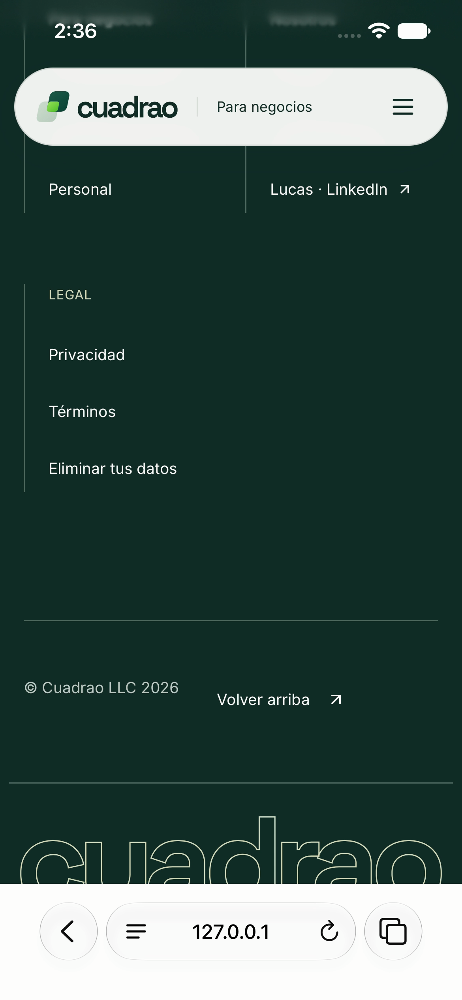
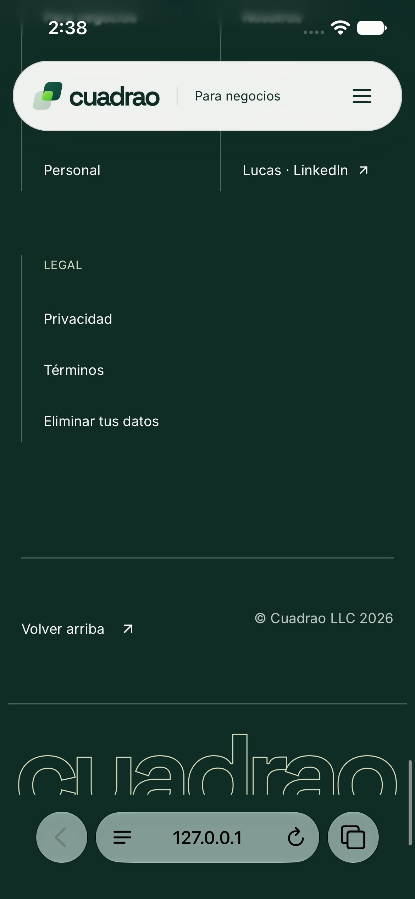
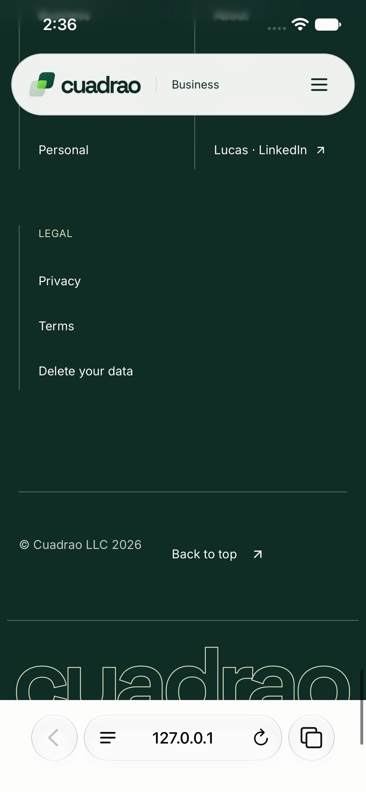
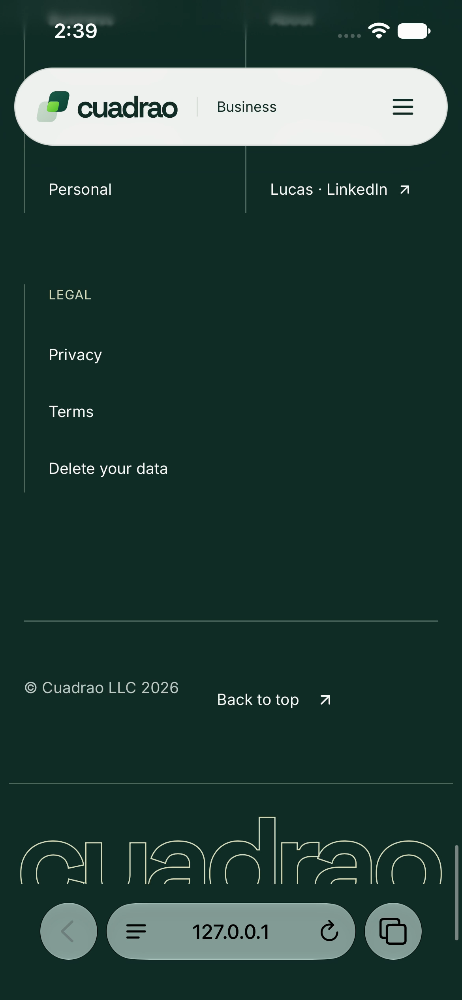
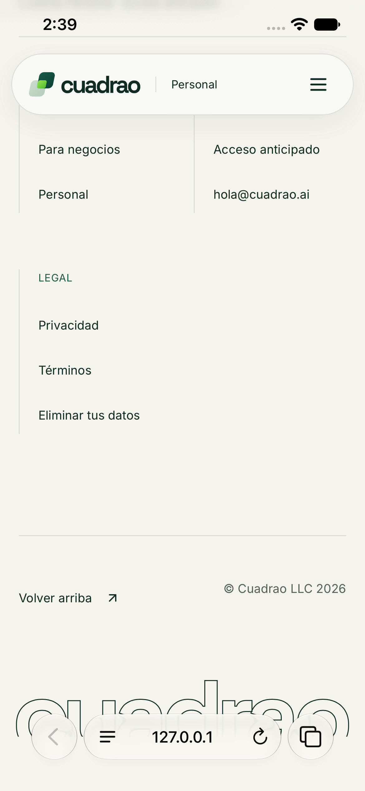
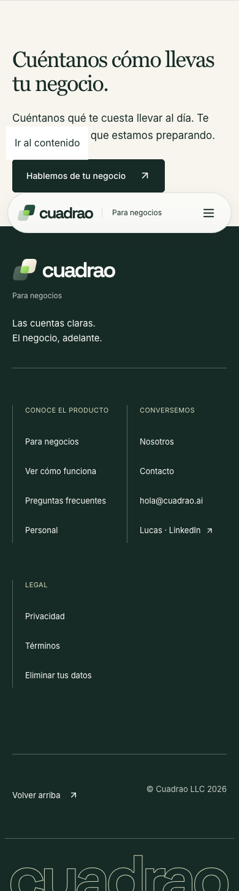
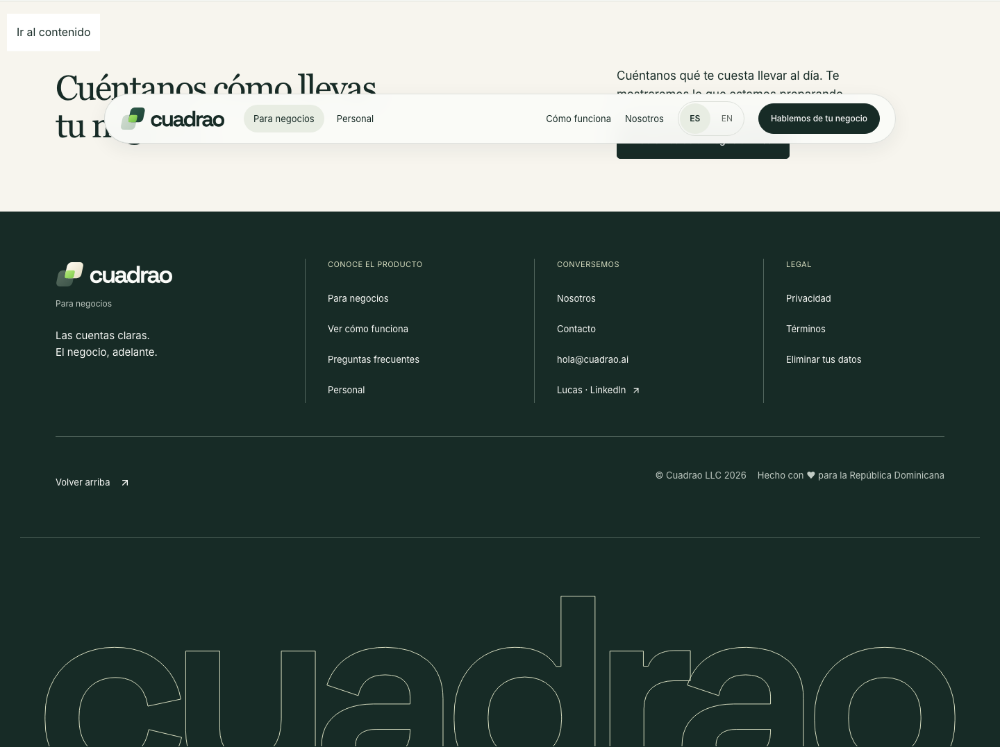
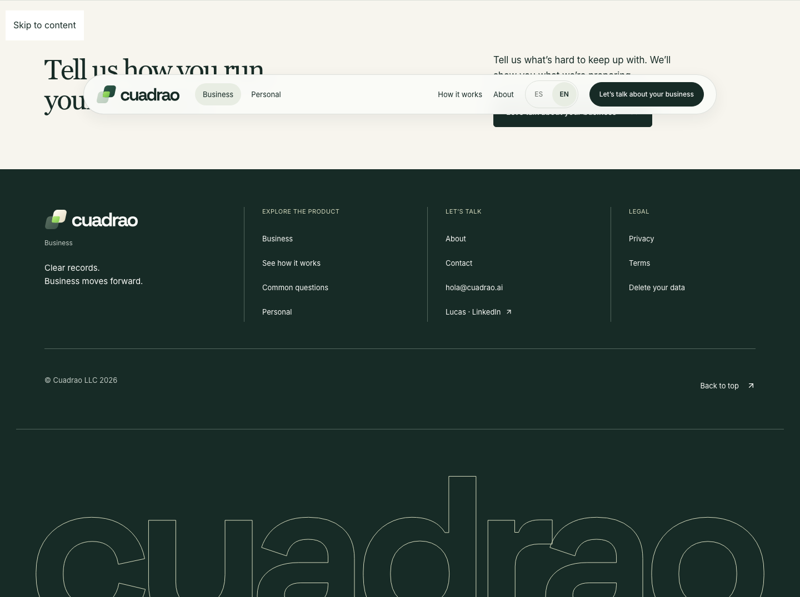
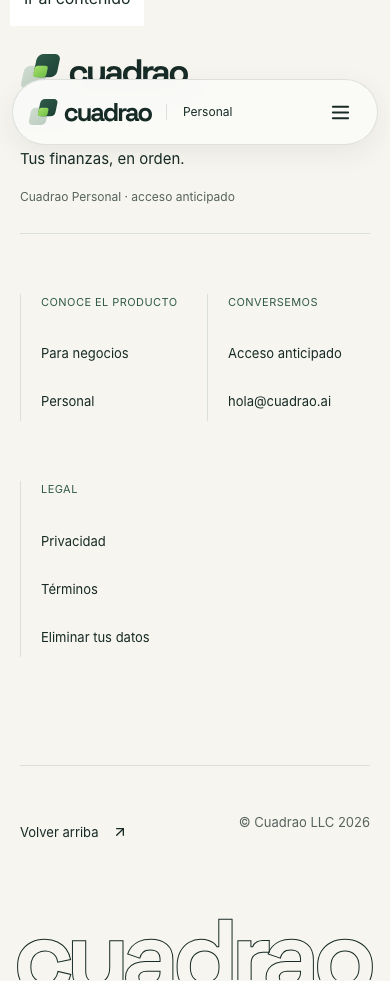

# Footer root-background verification

The page container and footer had their own colors, but `html` was transparent and `body` was white. A forceful bottom scroll in native iOS Safari exposed that white canvas below the footer.

The home pages now mark their root background as Business. Personal marks its root background as Personal. Global CSS reads those markers and colors both `html` and `body` dark green `#172b26` or cream `#f7f5ef`. Other page backgrounds are unchanged. This avoids a client effect or a second route lookup, and it does not change layout or the landed footer-credit interaction.

Owner is `codex/marketing-footer-background`. Detection is `marketing/e2e/footer-background.spec.ts`, plus the existing footer regression suite. Original integration base was `4599d7dc7d2ba0f6ba80af87350b3a92113a11c5`. The lane merged integration `c35aef09a487c3961c176df42364fe6ded092c33` one-way before the fix. This preserves #1197 intact.

## Results

- Baseline root-canvas test failed on all three routes. Expected the page color; received transparent `html` with white `body`.
- The combined footer suites passed 24 tests at 390px and 1440px. Both roots have the approved color, the footer spans the viewport, there is no horizontal overflow, and the page ends at the footer.
- The existing hover, mouseout, reduced-motion, mobile-credit and product-link checks pass.
- Production build, focused lint, TypeScript, ownership and modularity checks pass.
- Native iOS Safari 27.0 on one iPhone 17e simulator received fast upward swipes at the bottom of `/`, `/en` and `/personal`. The before recordings expose white below the Business footer. The after recordings show dark green on both home pages and cream on Personal. This is simulator Safari evidence, not a physical-phone claim.

The desktop logo already uses the same light-ink SVG on `/` and `/en`. Its filename `cuadrao-lockup-dark.svg` means it is intended for a dark background; its wordmark fill is `#fafbf8`. Swapping to `light.svg` would put dark ink on the dark footer. The loaded-image tests and desktop screenshots verify the existing correct contrast, so no logo code was changed. Initial first-page metrics sampled the lazy image before decode; the after probe waits for image decode and confirms natural width 268.

## Native Safari before and after

| Route | Before | After | Recording |
| --- | --- | --- | --- |
| `/` |  |  | [Before](ios-before-es.mp4), [after](ios-after-es.mp4) |
| `/en` |  |  | [Before](ios-before-en.mp4), [after](ios-after-en.mp4) |
| `/personal` | Not claimed defective |  | [After](ios-after-personal.mp4) |

## Layout and logo checks

[Before geometry](probe-before.json) and [after geometry](probe-after.json) record each route at 390px and 1440px. The earlier baseline predates the separately landed #1197 footer-credit change; this lane adds only background colors and page markers.

| Page | 390px after | Desktop after |
| --- | --- | --- |
| Spanish home |  |  |
| English home |  |  |
| Personal |  |  |

Run `bun run build --webpack` in `marketing/`, then `bunx playwright test e2e/footer-background.spec.ts e2e/footer.spec.ts` using the existing local synthetic provider configuration. No form submissions, hosted changes or paid model calls were used.
