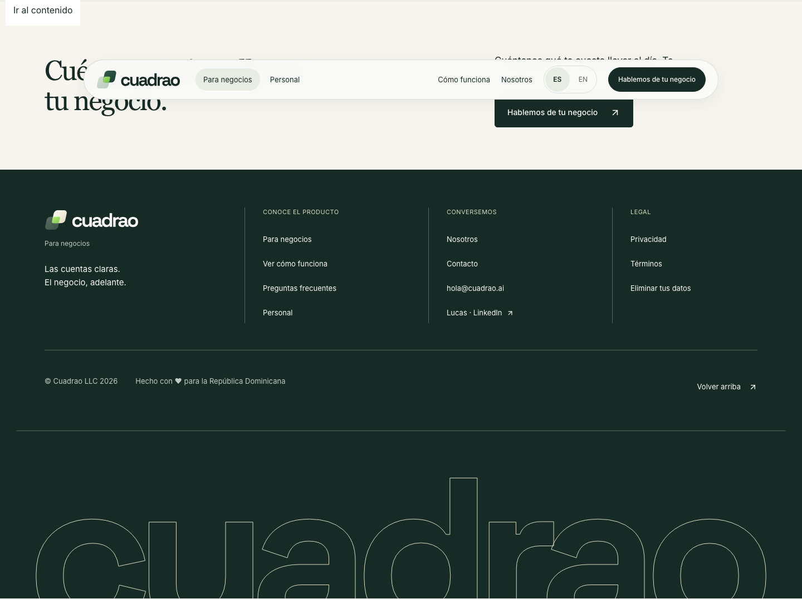
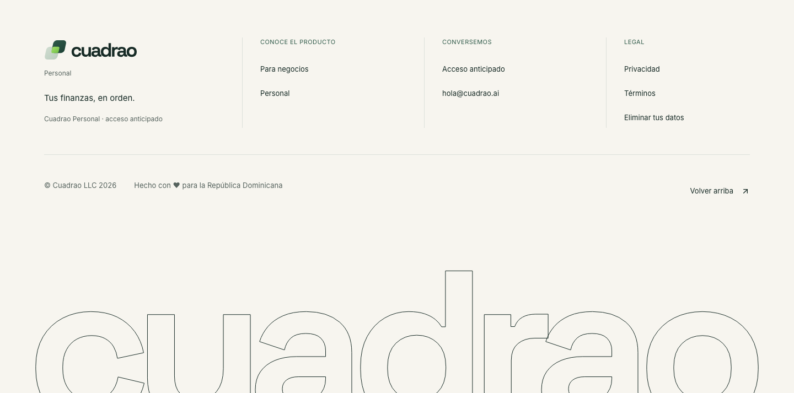

# Marketing footer check

Lucas approved these changes on October 16, 2026.

The Spanish home and Personal pages retain one `© Cuadrao LLC 2026` line and add `Hecho con ♥ para la República Dominicana`. The home footer's `Ver cómo funciona` link opens `#el-producto`, matching the hero. Existing English copy, other pages, layout and forms stay unchanged.

Owner: `codex/marketing-footer-bounded`. The shared footer keeps its existing styles and one optional presentation prop. No CSS, data or email changes are needed. Detection is the footer browser suite, including navigation to the visible product section.

## Local evidence

The initial integration base was `8631f4dea640cd52c81ece06e132b94782d5f8a0`.

- `bun run build --webpack` passed.
- `bunx eslint components/business-footer.tsx e2e/footer.spec.ts` passed.
- `bun run typecheck` passed.
- `CI=1 MARKETING_E2E_MOCK_PORT=4700 MARKETING_E2E_SITE_PORT=4701 MARKETING_E2E_PUBLIC_PORT=4702 bunx playwright test e2e/footer.spec.ts` passed all 14 tests across desktop and mobile.
- `python3 scripts/check_modularity_budget.py` passed.

The baseline check reproduced the missing local-credit line. A first follow-up run reused the retiring baseline server and was stopped. The recorded 14-test pass used fresh ports and disabled server reuse. All runs used the package's synthetic provider configuration. No form was submitted and no hosted service was changed.

Screenshots show the rendered local production build at 1440px. Final-head verification is recorded in the PR.

| Page | Before | After |
| --- | --- | --- |
| Home |  |  |
| Personal |  |  |
