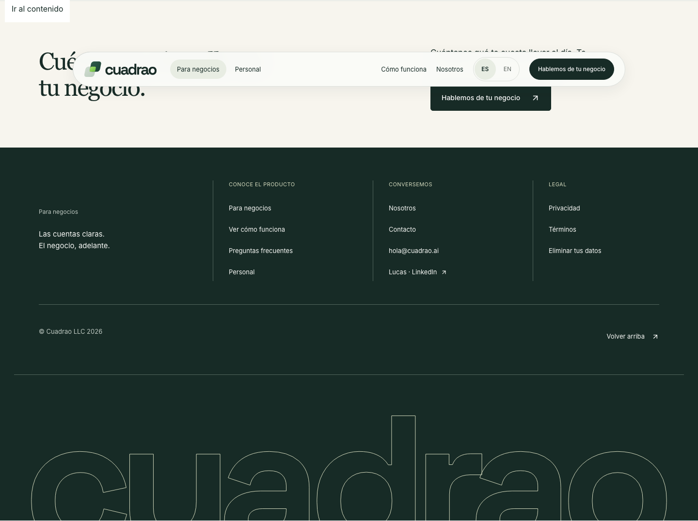
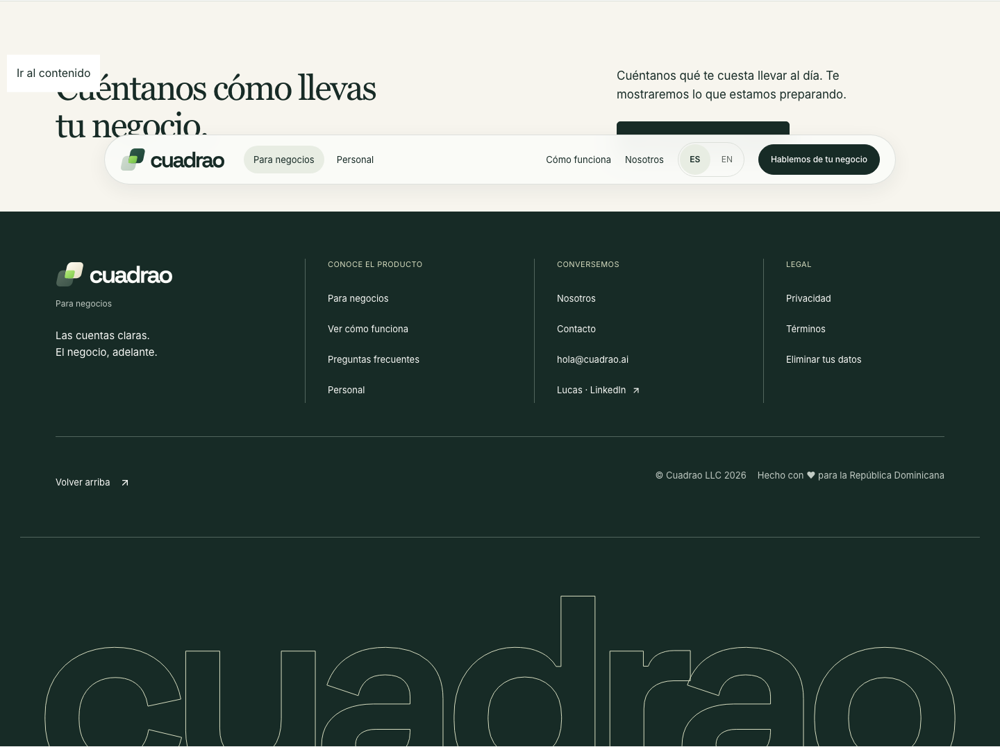
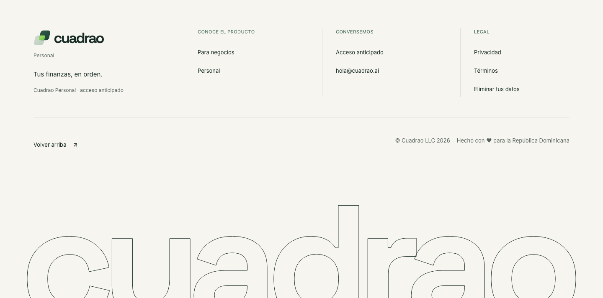
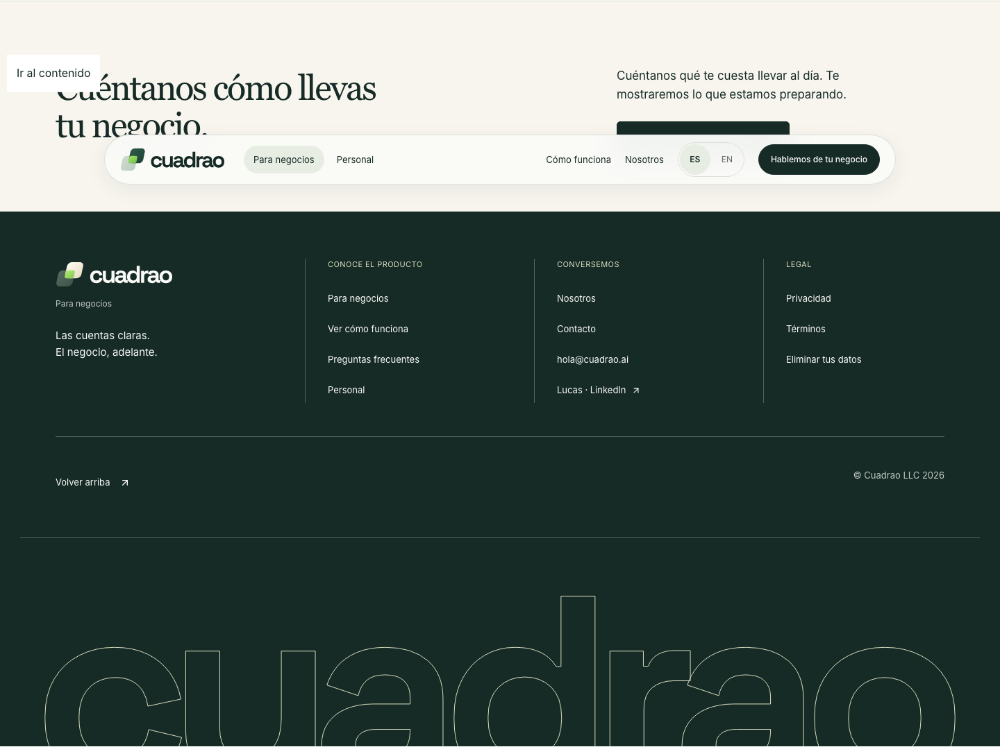
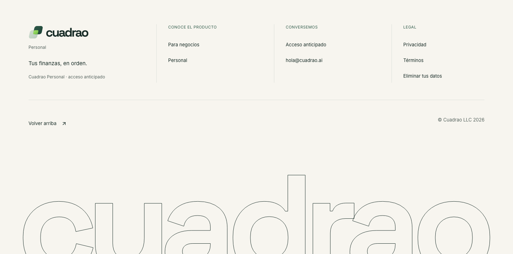

# Marketing footer check

Lucas approved these changes on October 16, 2026.

The Spanish home and Personal pages keep `© Cuadrao LLC 2026` in the bottom-right corner. Hover reveals `Hecho con ♥ para la República Dominicana` beside it. The copyright moves left over 700ms. The credit reveals right-to-left over 500ms after a 100ms delay. Both use ease-out, and mouseout reverses without delay. Both texts retain the existing secondary grey. The home footer's `Ver cómo funciona` link opens `#el-producto`, matching the hero.

Owner: `codex/marketing-footer-bounded`. Existing English copy, other pages and forms stay unchanged. The existing `Volver arriba` link stays in the bottom bar, before the credits. A CSS grid lets the text determine the reveal width without measuring text in JavaScript. Detection is the footer browser suite with real geometry, navigation, hover reversal and responsive checks.

## Local evidence

The initial integration base was `8631f4dea640cd52c81ece06e132b94782d5f8a0`. Integration `4599d7dc7d2ba0f6ba80af87350b3a92113a11c5` was merged one-way. Only the ownership registry overlapped; both entries remain.

- `bun run build --webpack` passed.
- `bunx eslint components/business-footer.tsx e2e/footer.spec.ts` passed.
- `bun run typecheck` passed.
- `CI=1 MARKETING_E2E_MOCK_PORT=4720 MARKETING_E2E_SITE_PORT=4721 MARKETING_E2E_PUBLIC_PORT=4722 bunx playwright test e2e/footer.spec.ts` passed all 14 tests across desktop and mobile.
- `python3 scripts/check_modularity_budget.py` passed.

The small-screen boundary uses the existing 800px breakpoint. Below it, the credit stays hidden even with reduced motion. Larger reduced-motion screens show both texts without animation. This resolves the combined small-screen and reduced-motion requirements without a new breakpoint.

The initial baseline check reproduced the missing local-credit line. A first follow-up run reused the retiring baseline server and was stopped. All recorded passes used fresh ports and disabled server reuse. All runs used synthetic provider configuration. No form was submitted and no hosted service was changed. Final-head verification is recorded in the PR.

| State | Home | Personal |
| --- | --- | --- |
| Original |  |  |
| Rest |  |  |
| Hover |  |  |
| Mouseout |  |  |
| Reduced motion |  |  |
| Mobile |  |  |
